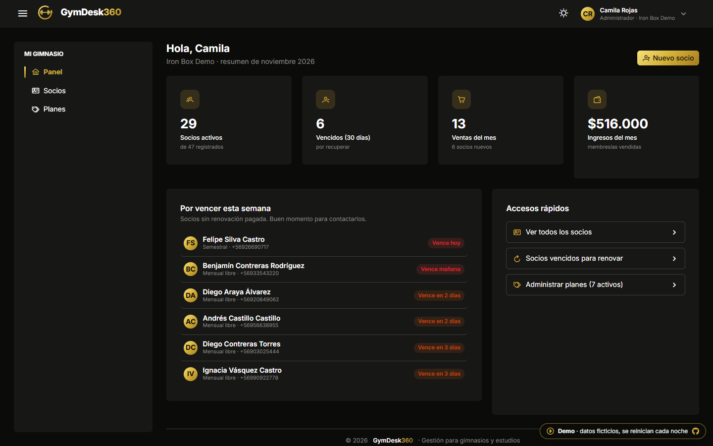
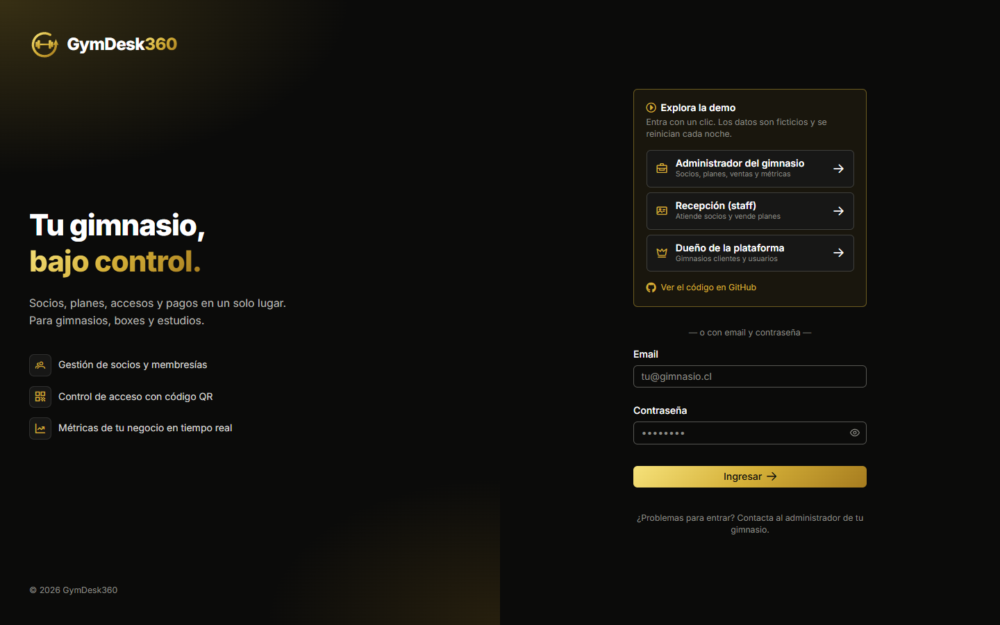
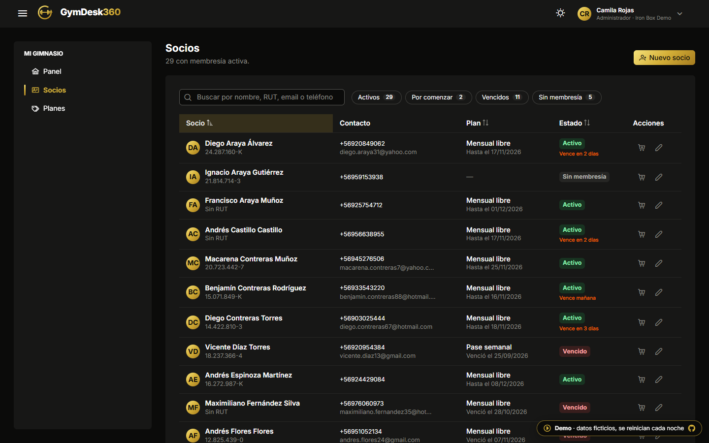
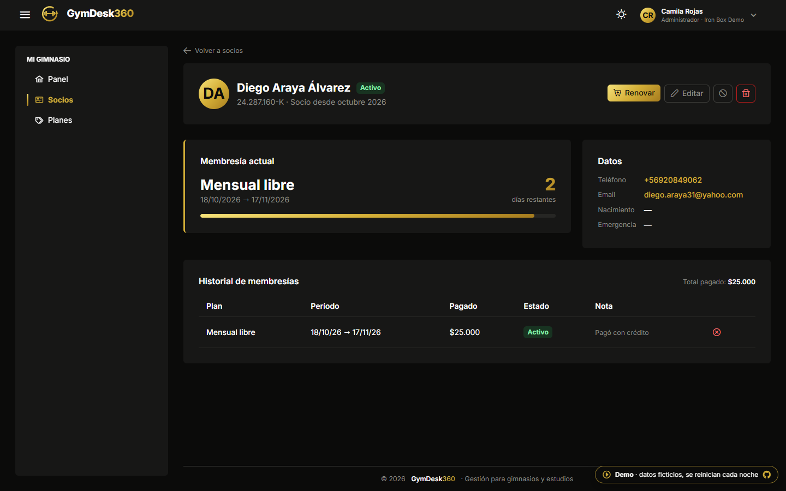
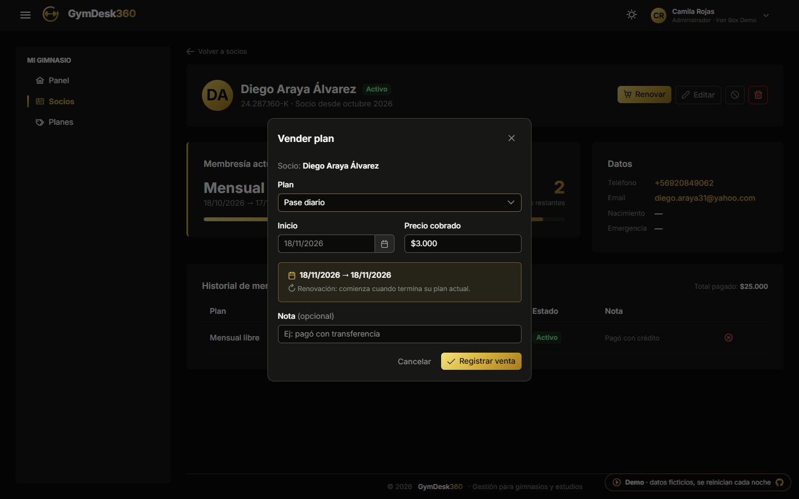
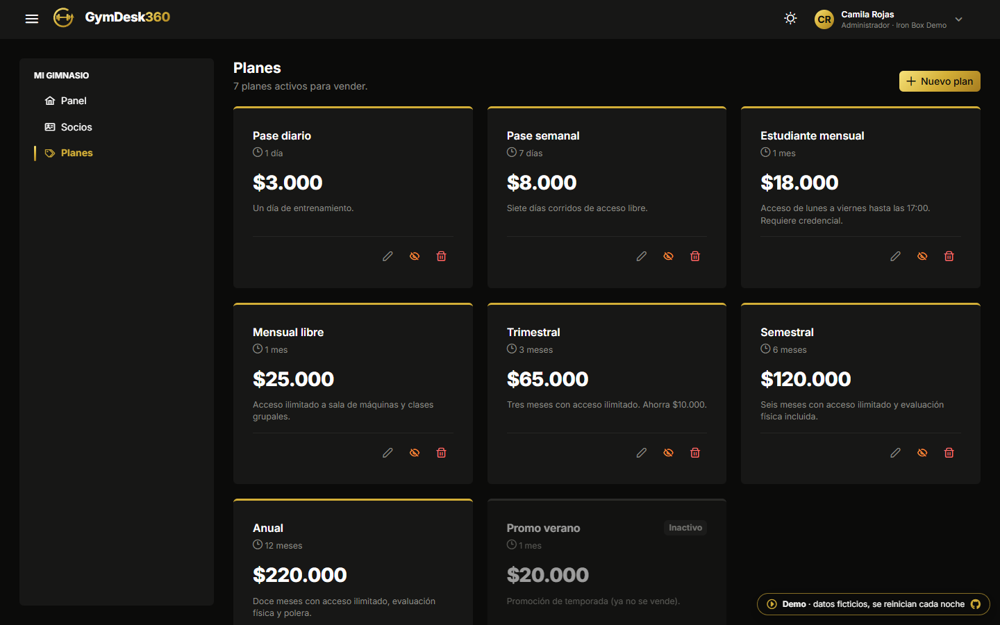
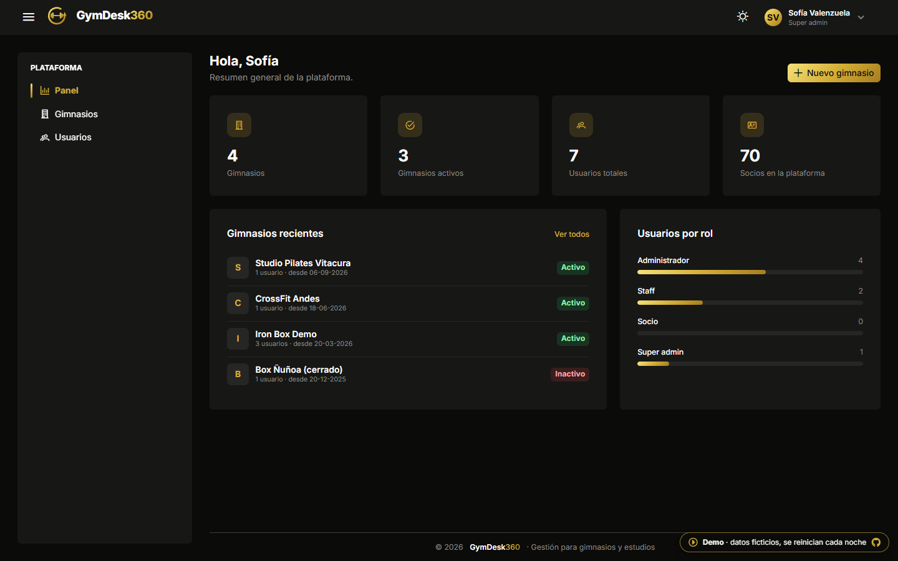
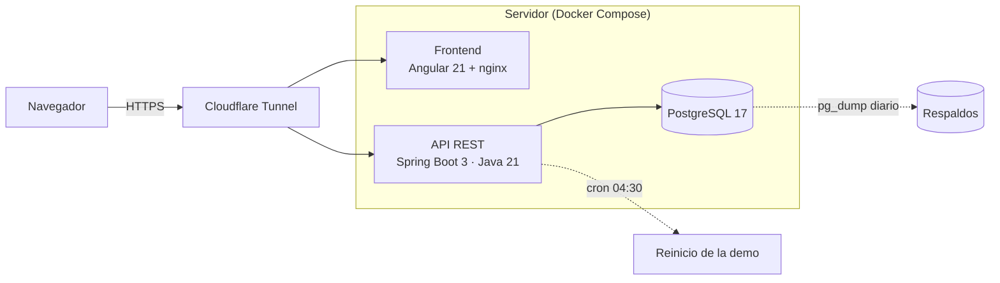

<div align="center">


# GymDesk360

**SaaS multi-gimnasio para gestionar socios, planes y membresías.**

[**▶ Probar la demo**](https://demo-gymdesk.benzprojects.site) · entra con un clic, sin registrarte


</div>



## ¿Qué es?

GymDesk360 es una plataforma SaaS para gimnasios, boxes y estudios. Cada gimnasio cliente tiene sus propios socios, planes y ventas, **completamente aislados** de los demás, y el dueño de la plataforma administra a todos los clientes desde un panel central.

La demo pública tiene tres cuentas para recorrerla desde distintos roles:

| Cuenta | Qué puede hacer |
|---|---|
| **Administrador del gimnasio** | Socios, planes, ventas, anulaciones y métricas de su gimnasio |
| **Recepción (staff)** | Registrar socios y vender planes; ve los planes pero no los modifica |
| **Dueño de la plataforma** | Gimnasios clientes, sus usuarios y métricas globales |

> Los datos son ficticios y se regeneran cada noche, con fechas relativas al día actual: siempre hay socios activos, por vencer y vencidos.

## Funcionalidades

**Gestión del gimnasio**
- Planes con precio en pesos y duración en meses de calendario o días (mensual, trimestral, pase diario…).
- Socios con **RUT validado** (dígito verificador módulo 11), contacto de emergencia y notas.
- Venta de membresías con **renovación automática** (la nueva empieza al día siguiente de la vigente), descuentos, ventas con fecha pasada y anulación.
- Estado de cada socio (activo, por comenzar, vencido, sin membresía) calculado en **hora de Chile**, no en la del servidor.
- Panel con socios activos, quiénes vencen esta semana sin haber renovado, ventas e ingresos del mes.

**Plataforma**
- Multi-tenant: cada gimnasio solo ve sus datos (verificado con tests de aislamiento).
- Roles `SUPER_ADMIN`, `ADMIN`, `STAFF` y `MEMBER` con permisos por endpoint.

**Seguridad**
- JWT con access token corto (15 min) y **refresh token rotativo** guardado como hash SHA-256.
- **Detección de robo de tokens**: reutilizar un refresh token ya rotado revoca todas las sesiones del usuario.
- Límite de intentos de login por IP y por email (429 ante fuerza bruta).
- Contraseñas con BCrypt, login con tiempo constante (no revela si el email existe), CORS estricto y cabeceras de seguridad.

## Capturas

| | |
|---|---|
|  |  |
|  |  |
|  |  |

## Arquitectura



| Capa | Tecnología |
|---|---|
| **Backend** | Spring Boot 3.4, Spring Security, Spring Data JPA / Hibernate 6, Flyway, jjwt, Bean Validation, springdoc (Swagger) |
| **Frontend** | Angular 21 (standalone, signals, zoneless), PrimeNG 21 con tema propio, Tailwind CSS 4 |
| **Base de datos** | PostgreSQL 17, migraciones versionadas con Flyway |
| **Infraestructura** | Docker multi-stage, Docker Compose, nginx, Cloudflare Tunnel, respaldos automáticos con `pg_dump` |
| **Tests** | JUnit 5 (RUT, fechas de término), pruebas de integración de la API, E2E en navegador con Playwright |

### Estructura

```
back-gymdesk360/            API REST (Spring Boot)
  src/main/java/.../
    config/                 Seguridad, CORS, OpenAPI, reloj de negocio
    controller/             Endpoints REST
    service/                Reglas de negocio
    repository/             Spring Data JPA
    model/                  Entidades JPA
    dto/                    request / response
    security/               JWT, filtro, límite de intentos
    demo/                   Datos de la demo y protecciones
  src/main/resources/db/migration/   Migraciones Flyway
gymdesk360-front/           SPA Angular
  src/app/
    core/                   Auth, interceptor, servicios de API, tema
    layout/                 Topbar, sidebar, menú por rol
    pages/                  admin/ (plataforma) y gym/ (gimnasio)
    shared/                 Componentes y utilidades reutilizables
scripts/                    Despliegue y respaldos
```

### Decisiones de diseño

- **Venta ≠ plan.** Cada membresía guarda el nombre y el precio del plan al momento de venderla: editar un plan no reescribe el historial.
- **Fechas de negocio con `Clock` inyectado** en la zona del gimnasio: una membresía no "vence" a las 21:00 porque el servidor está en UTC.
- **Aislamiento por gimnasio en la capa de servicio**: toda consulta filtra por el `gymId` del token; acceder a un recurso de otro gimnasio responde 404 (no revela que existe).
- **Refresh tokens con estado `rotated`** para distinguir un token canjeado (su reuso indica robo) de uno revocado por logout o cambio de contraseña.

## Ejecutar en local

Requisitos: Docker. Para desarrollar el frontend, Node 22+.

```bash
git clone https://github.com/bnzzzy/GymDesk360-demo.git
cd GymDesk360-demo/back-gymdesk360
cp .env.example .env            # completa DB_PASSWORD y JWT_SECRET (openssl rand -base64 48)
docker compose up -d --build    # API en http://localhost:8084 · Swagger en /swagger-ui.html
```

Con `DEMO_ENABLED=true` la base se carga con datos de ejemplo al arrancar.

```bash
cd ../gymdesk360-front
npm install
npm start                       # http://localhost:4200
```

> Para que el frontend local use tu API local, cambia `target` en `proxy.conf.json` a `http://localhost:8084`.

## Autor

**Benjamín López** · [benzprojects.site](https://benzprojects.site)

La interfaz parte de la plantilla [Sakai-NG](https://github.com/primefaces/sakai-ng) de PrimeTek (MIT); el diseño, el tema y todas las funcionalidades son propios.
